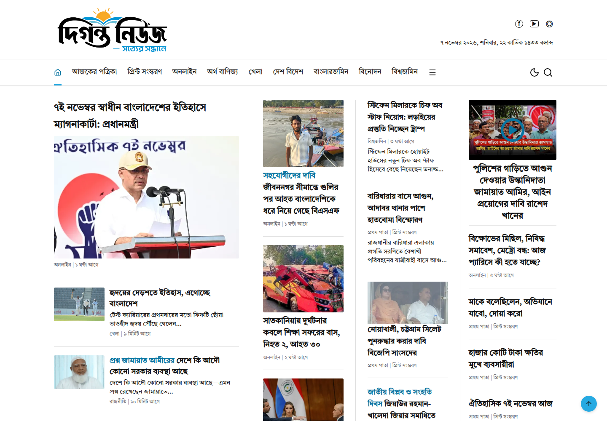

# Diganta News

[Live website](https://bhalukbeautiful.vercel.app)

React + Vite + Tailwind CSS Bengali news frontend, built from direct Playwright inspection of mzamin.com. Uses the supplied দিগন্ত নিউজ brand and a transparent logo cutout.



## Run

```sh
npm install
npm run dev
```

`npm run build` creates `dist/`. Configure your production host to serve `index.html` for frontend routes.

## Pages

- `/`: newspaper homepage
- `/category/:slug`: all 21 reference categories (Bengali names with spaces replaced by hyphens)
- `/article/:id`: article detail, text sizing, copying, printing, related news
- `/newstoday`: today's newspaper sections
- `/print`: print edition with date selector and full-page viewer (arrow keys and Escape supported)
- `/archive-calendar`: month navigation and date selection
- `/archive?date=YYYY-MM-DD`: archive listing
- `/search?q=...`: news search
- `/videos`: video page
- `/about`, `/contact`, `/privacy`: branded informational placeholders

## Backend integration

The single adapter is `src/services/news.js`. Set `VITE_API_BASE_URL` to load `GET /site-data` instead of bundled data. The response shape is:

```ts
type NewsDataset = {
  articles: Record<string, {
    id: string;
    title: string;
    image: string;
    summary: string;
    meta: string;
    category: string;
    body?: string[];
  }>;
  categories: Record<string, string[]>; // category name → ordered article IDs
  homeIds: string[]; // ordered homepage stories
  papers: string[]; // print-page image URLs
};
```

Reference news and print images are fixtures for visual review. Replace these with your publication's content before launch. Dates on the demo reproduce the reference capture (7 November 2026). Search works on the loaded dataset. The date selectors currently change the selected date; a backend should supply historical stories/editions. Contact and editorial information need your real details. Third-party advertising overlays were omitted.

Reference screenshots are in `docs/reference/`. Verification screenshots are in `docs/verification/`.

## Brand colors

Shared CSS tokens in `src/style.css` use the new logo's sampled cyan `#27AAE2`, ink `#111111`, and gold `#FCB040`. White surfaces and neutral metadata keep the news readable. Cyan fills use ink text; a darker cyan `#0875A1` keeps small links legible on white. Gold marks the current calendar date. Dark mode uses lighter cyan accents.

`public/assets/diganta-logo-transparent.png` is the active RGBA logo cutout with a transparent background. Header, menu, footer, and favicon use it. The SVG file wraps that PNG for compatibility; it is not a vector tracing. The original supplied image remains in `diganta-logo-original.png`. Dark mode recolors dark lettering with an SVG display filter while retaining the colored book and sun, without a backing rectangle.

## Runtime services

The frontend downloads Tiro Bangla from Google Fonts and loads YouTube thumbnails/video from YouTube. News images used by the bundled fixtures are stored locally. The project is an independent implementation inspired by mzamin.com and is not affiliated with that publication.

## Vercel deployment

`vercel.json` configures the Vite production build and SPA fallback for direct article/category URLs. Run `vercel --prod` with an authenticated Vercel CLI. Local Vercel credentials and project metadata remain untracked. Configure `VITE_API_BASE_URL` in the Vercel project when connecting a backend.
